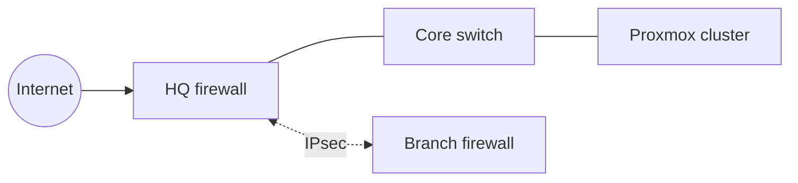

# Network

## VLANs

=== "HQ"

    | VLAN | Name | Subnet |
    |---|---|---|
    | 10 | Management | 10.10.10.0/24 |
    | 20 | Servers | 10.10.20.0/24 |

=== "Branch"

    | VLAN | Name | Subnet |
    |---|---|---|
    | 10 | Management | 10.20.10.0/24 |
